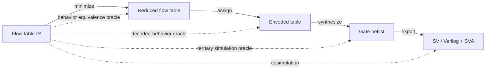

# huffman-eda

A small, verification-first EDA toolkit for asynchronous sequential circuits under the
**Huffman model** operating in **fundamental mode**. It follows the synthesis flow from
*Algorithms for Synthesis and Testing of Asynchronous Circuits*: flow table capture,
state minimization, state assignment, hazard-free logic, and HDL export.

## Approach

The project is not a pile of separate checks. It is a pipeline of intermediate
representations (IRs). Every transformation is checked by an **independent oracle**
rather than trusted. This is translation validation, the same idea as a scoreboard
checking a DUT against a reference model.



1. **Executable semantics first.** `settle()` and `explore()` define what a flow table
   *means* under single-input-change fundamental mode. Every validation rule is a query
   over that semantics, never a separate ad-hoc algorithm.
2. **Frozen spec, protected golden data.** `docs/SEMANTICS.md` and `tests/golden/` are
   owner-controlled. Agents implement against them and cannot edit them.
3. **Machine-readable diagnostics.** Every check returns structured `Diagnostic`
   records (`hfe validate --json`). That JSON is the feedback channel for agents.
4. **Property-based testing.** Random flow tables (Hypothesis) exercise every pass
   against its oracle, beyond the hand-built golden cases.

## Layout

| Path | Purpose |
|---|---|
| `AGENTS.md` | Operating rules and roles for the author agent (read first) |
| `REVIEWER.md` | Instructions for the independent reviewer agent |
| `reference/` | Independent reference implementation (reviewer-owned) |
| `docs/SEMANTICS.md` | Normative definitions: file format, settle, explore, rules |
| `docs/ARCHITECTURE.md` | Package layout and IR levels |
| `docs/ROADMAP.md` | Milestones, task index, dependencies |
| `tasks/` | One file per task, one task per PR |
| `tests/golden/` | Append-only reference tables with expected results |
| `docs/spec_lock.json` | Hashes freezing completed SEMANTICS sections and harnesses |

## Development

```bash
python -m venv .venv && source .venv/bin/activate
pip install -e ".[dev]"
ruff check . && ruff format --check . && mypy && pytest -q -rs
```
